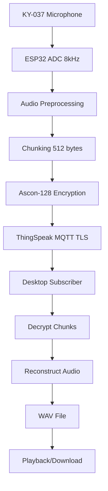

# Audio Encryption System with Ascon-128 and MQTT

Sistem keamanan informasi untuk audio recording menggunakan enkripsi **Ascon-128** (lightweight authenticated encryption) dengan transmisi melalui **ThingSpeak MQTT broker** over TLS.

## 📋 Overview

Sistem ini terdiri dari dua komponen utama:

1. **ESP32 Publisher** (MicroPython) - Merekam audio dari sensor KY-037, mengenkripsi per-chunk dengan Ascon-128, dan publish ke ThingSpeak MQTT
2. **Desktop Subscriber GUI** (Python/Tkinter) - Subscribe dari ThingSpeak, dekripsi chunks, reconstruct audio, dan playback

### Alur Kerja System

```
Microphone (KY-037) → ESP32 ADC Sampling → Audio Preprocessing 
→ Chunking & Sequencing → Per-Chunk Encryption (Ascon-128) 
→ MQTT over TLS (ThingSpeak) → Desktop Subscriber 
→ Decryption & Verification → Audio Reconstruction → Playback/Download
```

## 🔧 Hardware Requirements

### ESP32 Publisher
- **ESP32 DevKit** atau board compatible (ESP32-WROOM-32)
- **KY-037 Sound Detection Sensor Module**
  - Analog output untuk audio sampling
  - Adjustable sensitivity via potentiometer
- **Jumper wires** untuk koneksi
- **USB cable** untuk programming dan power
- **WiFi network** dengan internet access

### Desktop Subscriber
- **Windows/Linux/Mac** computer
- **Python 3.8+** installed
- **Internet connection** untuk MQTT broker

## 📦 Software Requirements

### ESP32 Publisher
- **MicroPython firmware** untuk ESP32
- Files yang perlu diupload ke ESP32:
  - `Publisher.py` - Main program
  - `ascon.py` - Ascon-128 encryption library

### Desktop Subscriber
- **Python 3.8+**
- Dependencies (lihat `requirements.txt`):
  - paho-mqtt
  - pygame
  - numpy, scipy
  - matplotlib
  - python-dotenv
  - tkinter (built-in)

## 🚀 Quick Start

### 1. Setup ThingSpeak Account

1. Buat account di [ThingSpeak](https://thingspeak.com/)
2. Create new channel dengan minimal 4 fields
3. Generate MQTT credentials:
   - Go to **Devices** → **MQTT**
   - Note: Client ID, Username, Password
4. Catat **Channel ID** dari channel settings

Detail lengkap: lihat [`docs/thingspeak.md`](docs/thingspeak.md)

### 2. Setup ESP32 Publisher

1. **Install MicroPython** ke ESP32
2. **Upload files** ke ESP32:
   ```bash
   # Upload ascon.py
   ampy --port COM3 put ascon.py
   
   # Upload Publisher.py
   ampy --port COM3 put Publisher.py
   ```
3. **Edit `Publisher.py`** - Update WiFi dan ThingSpeak credentials
4. **Wiring KY-037** ke ESP32:
   - VCC → 3.3V
   - GND → GND
   - A0 → GPIO 34

Detail lengkap: lihat [`docs/setup.md`](docs/setup.md)

### 3. Setup Desktop Subscriber

1. **Clone/download** project ini
2. **Create `.env` file** dari template:
   ```bash
   cp .env.example .env
   ```
3. **Edit `.env`** - Isi ThingSpeak credentials Anda
4. **Install dependencies**:
   ```bash
   pip install -r requirements.txt
   ```
5. **Run subscriber GUI**:
   ```bash
   python subscriber_gui.py
   ```

### 4. Run the System

1. **Power ON ESP32** - Monitor serial output (115200 baud)
2. **Launch subscriber GUI** - Klik "Connect to MQTT"
3. **Trigger recording** di ESP32 (auto atau button)
4. **Wait for chunks** - Monitor progress di GUI
5. **Decrypt audio** - Klik "Decrypt Audio" setelah semua chunks diterima
6. **Play atau download** audio

## 📊 System Architecture



Detail arsitektur lengkap: lihat [`docs/architecture.md`](docs/architecture.md)

## 🔐 Security Features

- **Ascon-128 AEAD**: Authenticated encryption dengan 128-bit security
- **Unique nonce per chunk**: Timestamp + sequence number kombinasi
- **Associated data**: Metadata verification (sequence, timestamp)
- **TLS/SSL**: MQTT transport encryption
- **Replay protection**: Timestamp validation
- **Sequence integrity**: Chunk ordering verification

Detail security: lihat [`docs/security.md`](docs/security.md)

## 📖 Documentation

- **[Setup Guide](docs/setup.md)** - Installation dan konfigurasi step-by-step
- **[Architecture](docs/architecture.md)** - System design dan component breakdown
- **[Usage Guide](docs/usage.md)** - Cara menggunakan ESP32 dan GUI subscriber
- **[ThingSpeak Configuration](docs/thingspeak.md)** - Setup ThingSpeak account dan MQTT
- **[Security Considerations](docs/security.md)** - Penjelasan keamanan sistem

## 🛠️ Troubleshooting

### ESP32 tidak connect ke WiFi
- Check WiFi credentials di `Publisher.py`
- Pastikan WiFi network stabil dan internet accessible
- Monitor serial output untuk error messages

### Subscriber tidak receive data
- Verify ThingSpeak credentials di `.env` file
- Check firewall tidak block port 8883
- Pastikan Channel ID benar

### Audio playback error
- Install/reinstall pygame: `pip install pygame --upgrade`
- Check audio drivers di OS
- Verify WAV file created successfully

### Missing chunks
- Check network stability
- ESP32 might lose connection - implement retry logic
- ThingSpeak free tier has rate limits

Detail troubleshooting: lihat [`docs/usage.md`](docs/usage.md)

## 📝 Technical Specifications

| Component | Specification |
|-----------|--------------|
| **Encryption** | Ascon-128 AEAD |
| **Key Size** | 128 bits (16 bytes) |
| **Nonce** | 128 bits (unique per chunk) |
| **Sample Rate** | 8 kHz |
| **Audio Channels** | Mono (1 channel) |
| **Bit Depth** | 16-bit (after reconstruction) |
| **Chunk Size** | 512 bytes (configurable) |
| **MQTT Protocol** | MQTT v3.1.1 over TLS |
| **MQTT QoS** | 1 (at least once delivery) |

## 🤝 Contributing

Contributions are welcome! Silakan buat issue atau pull request.

## 📄 License

This project is for educational purposes (Keamanan Informasi course project).

## 👥 Authors

- Project untuk mata kuliah Keamanan Informasi
- Using Ascon-128 cipher implementation
- ThingSpeak MQTT IoT platform

## 🔗 References

- [Ascon Cipher](https://ascon.iaik.tugraz.at/) - Official Ascon specification
- [ThingSpeak MQTT](https://www.mathworks.com/help/thingspeak/mqtt-api.html) - MQTT API documentation
- [MicroPython](https://micropython.org/) - MicroPython documentation
- [ESP32](https://docs.espressif.com/projects/esp-idf/en/latest/esp32/) - ESP32 documentation

---

**Status**: ✅ Implemented and tested

**Last Updated**: November 2025
