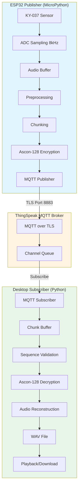
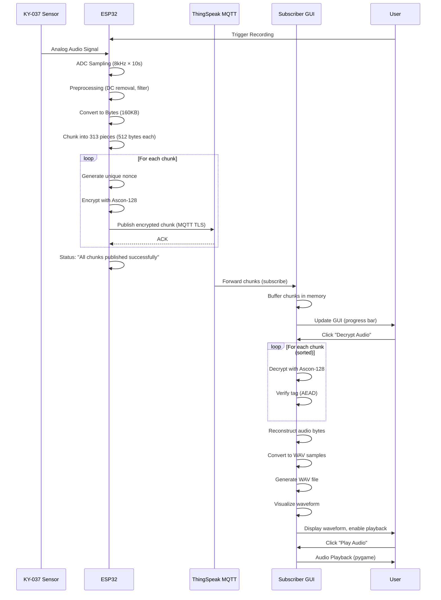

# System Architecture - Audio Encryption with Ascon-128

Dokumentasi lengkap arsitektur sistem enkripsi audio menggunakan Ascon-128 dan MQTT.

## Table of Contents
- [High-Level Architecture](#high-level-architecture)
- [Component Breakdown](#component-breakdown)
- [Data Flow](#data-flow)
- [Security Architecture](#security-architecture)
- [Technical Specifications](#technical-specifications)

---

## High-Level Architecture

### System Overview Diagram



### Three-Tier Architecture

1. **Edge Tier (ESP32)**
   - Audio capture dan preprocessing
   - Encryption dan chunking
   - MQTT publishing

2. **Cloud Tier (ThingSpeak)**
   - MQTT message broker
   - Data persistence (optional)
   - Channel management

3. **Application Tier (Desktop)**
   - MQTT subscription
   - Decryption dan verification
   - Audio playback dan storage

---

## Component Breakdown

### 1. Audio Capture Module (ESP32)

**Hardware:**
- **KY-037 Sound Sensor**
  - Analog output: Variable voltage 0-3.3V
  - Digital output: Threshold trigger (not used)
  - Sensitivity: Adjustable via potentiometer

**ADC Configuration:**
```python
adc = ADC(Pin(34))
adc.atten(ADC.ATTN_11DB)  # 0-3.3V full range
adc.width(ADC.WIDTH_12BIT)  # 12-bit resolution (0-4095)
```

**Sampling:**
- **Sample Rate**: 8 kHz (8000 samples/second)
- **Sample Duration**: 10 seconds (configurable 5-10s)
- **Total Samples**: 80,000 per recording
- **Sampling Interval**: 125 microseconds per sample

**Buffer Management:**
- Dynamic array storage
- Periodic garbage collection
- Memory: ~160KB untuk 10s audio

### 2. Audio Preprocessing Pipeline

**Step 1: DC Offset Removal**
```python
avg = sum(samples) // len(samples)
normalized = [s - avg for s in samples]
```
- Purpose: Center audio around zero
- Removes DC component dari sensor

**Step 2: Moving Average Filter**
```python
window_size = 5
filtered = moving_average(samples, window=window_size)
```
- Purpose: Noise reduction
- Low-pass filter untuk smooth signal
- Trade-off: slight loss of high frequencies

### 3. Chunking & Sequencing Module

**Chunking Strategy:**
```
Raw Audio: 160,000 bytes (80,000 samples × 2 bytes)
Chunk Size: 512 bytes max
Total Chunks: ⌈160000 / 512⌉ = 313 chunks
```

**Chunk Metadata:**
```python
{
    "sequence": 1-313,
    "total_chunks": 313,
    "timestamp": unix_time,
    "size": 512  # last chunk might be smaller
}
```

**Sequence Numbering:**
- 1-indexed (chunk 1, 2, 3, ..., 313)
- Sequential ordering for reconstruction
- Missing chunk detection

### 4. Ascon-128 Encryption Module

**Algorithm: Ascon-128 AEAD**

**Configuration:**
```python
Key Size: 128 bits (16 bytes)
Nonce Size: 128 bits (16 bytes)
Associated Data: Variable length
Tag Size: 128 bits (16 bytes)
```

**Nonce Generation Strategy:**
```python
nonce = f"{prefix}{timestamp}{sequence:04d}"[:16].ljust(16, '0')
# Example: "asconcipher11732685123001"→16 bytes
```

**Uniqueness guarantee:**
- Timestamp: Unix epoch (changes every second)
- Sequence: 0001-9999 (unique per chunk)
- Combination ensures no nonce reuse

**Encryption Process:**
```
Plaintext (512 bytes)
    ↓
Ascon-128 AEAD (key, nonce, associated_data)
    ↓
Ciphertext + Tag (528 bytes)
```

**Associated Data:**
```python
AD = f"AUDIO_CHUNK_{sequence}_{timestamp}"
```
- Binds metadata ke ciphertext
- Verified during decryption
- Prevents chunk swap attacks

### 5. MQTT Publisher (ESP32)

**Connection Parameters:**
```python
Protocol: MQTT v3.1.1
Transport: TLS 1.2
Server: mqtt3.thingspeak.com
Port: 8883
QoS: 1 (at least once delivery)
Keep-Alive: 60 seconds
```

**Topic Structure:**
```
channels/{CHANNEL_ID}/publish
```

**Payload Format** (JSON):
```json
{
  "field1": "a5f3c2d1...",  // hex encrypted chunk (max 255 chars)
  "field2": "1",            // sequence number
  "field3": "313",          // total chunks
  "field4": "1732685123"    // timestamp
}
```

**Publishing Flow:**
```
1. Connect to WiFi
2. Connect to MQTT broker (TLS handshake)
3. For each chunk:
   a. Encrypt chunk
   b. Convert to hex
   c. Build JSON payload
   d. Publish to topic (QoS 1)
   e. Wait for ACK
   f. Delay 500ms (rate limiting)
4. Disconnect gracefully
```

### 6. MQTT Subscriber (Desktop)

**Subscription:**
```python
Topic: channels/{CHANNEL_ID}/subscribe/fields/+
QoS: 1
```

**Callback Flow:**
```
1. Receive MQTT message
2. Parse JSON payload
3. Extract encrypted_hex, sequence, total, timestamp
4. Store in buffer: chunks_buffer[sequence] = (data, metadata)
5. Update GUI (progress bar, text display)
6. If all chunks received: Enable decrypt button
```

### 7. Decryption & Verification Module

**Decryption Process:**
```
For each chunk (sorted by sequence):
    1. Convert hex → bytes
    2. Reconstruct nonce (same algorithm as publisher)
    3. Reconstruct associated data
    4. Decrypt: plaintext = ascon_decrypt(key, nonce, AD, ciphertext)
    5. Verify tag (AEAD verification)
    6. If verification fails: abort
    7. Append plaintext to buffer
```

**Security Checks:**
- **Nonce validation**: Reconstructed correctly
- **Tag verification**: AEAD authenticity check
- **Sequence integrity**: No missing chunks
- **Timestamp validation**: Within reasonable range (optional)

### 8. Audio Reconstruction Module

**Byte Stream → Audio Samples:**
```python
for i in range(0, len(data), 2):
    low_byte = data[i]
    high_byte = data[i+1]
    value_12bit = low_byte | (high_byte << 8)  # 0-4095
    value_16bit = (value_12bit - 2048) * 8     # Convert to signed 16-bit
    samples.append(value_16bit)
```

**WAV File Generation:**
```python
WAV Header:
    - Format: PCM
    - Sample Rate: 8000 Hz
    - Channels: 1 (Mono)
    - Bits per Sample: 16
    - Byte Rate: 16000 bytes/sec
    - Total Duration: 10 seconds

Data Chunk:
    - 80,000 samples × 2 bytes = 160,000 bytes
```

### 9. GUI & Visualization Module

**Tkinter Components:**
- **Status Panel**: Connection status, progress tracking
- **Control Panel**: Buttons untuk actions
- **Data Display**: ScrolledText untuk encrypted data
- **Metadata Display**: Chunk info
- **Waveform Panel**: Matplotlib embedded canvas

**Threading Model:**
- **Main Thread**: GUI event loop
- **MQTT Thread**: paho-mqtt loop_start()
- **Message Queue**: Thread-safe communication

**Waveform Visualization:**
```python
matplotlib.pyplot:
    - X-axis: Sample index (0-80000)
    - Y-axis: Amplitude (-32768 to +32767)
    - Plot: Line graph dengan 80,000 points
```

---

## Data Flow

### End-to-End Flow Diagram



### Data Transformation Pipeline

```
Stage 1: Audio Capture
    Analog Signal → ADC Values [0-4095]

Stage 2: Digitization
    ADC Values → 12-bit Samples → 16-bit Bytes

Stage 3: Preprocessing
    Raw Bytes → DC Removed → Filtered

Stage 4: Chunking
    160KB Audio → 313 Chunks (512 bytes each)

Stage 5: Encryption
    Plaintext Chunk → Ascon-128 → Ciphertext + Tag

Stage 6: Transmission
    Encrypted Bytes → Hex String → JSON → MQTT

Stage 7: Reception
    MQTT → JSON → Hex String → Encrypted Bytes

Stage 8: Decryption
    Ciphertext + Tag → Ascon-128 Verify → Plaintext Chunk

Stage 9: Reconstruction
    313 Chunks → Combined 160KB → 80000 Samples

Stage 10: Output
    Samples → WAV File → Audio Playback
```

---

## Security Architecture

### Encryption Layer

**Ascon-128 Properties:**
- **Confidentiality**: AES-level 128-bit security
- **Authentication**: 128-bit tag prevents tampering
- **Lightweight**: Optimized untuk embedded systems
- **NIST Competition**: Finalist di NIST LWC (2023 winner)

**Key Management:**
- **Static Key**: Hardcoded di both publisher dan subscriber
- **Key Distribution**: Manual (pre-shared key)
- **Rotation**: Not implemented (consider untuk production)

**Nonce Management:**
- **Generation**: Deterministic (timestamp + sequence)
- **Uniqueness**: Guaranteed per chunk
- **Collision Resistance**: Timestamp precision + sequence space

### Transport Security

**MQTT over TLS:**
```
Layer 7: MQTT Protocol
Layer 6: TLS 1.2 Encryption
Layer 5-4: TCP Connection
Layer 3: IP Routing
Layer 2-1: WiFi Physical
```

**TLS Configuration:**
- **Version**: TLS 1.2 minimum
- **Cipher Suites**: ThingSpeak managed
- **Certificate Validation**: Server certificate verified
- **Mutual TLS**: Not required (username/password auth)

### Attack Mitigation

| Attack Type | Mitigation |
|-------------|------------|
| **Eavesdropping** | TLS encryption + Ascon-128 |
| **Tampering** | AEAD tag verification |
| **Replay Attack** | Timestamp validation (optional) |
| **Chunk Reordering** | Sequence numbers + AD binding |
| **Man-in-the-Middle** | TLS server certificate validation |
| **Brute Force** | 128-bit key space (2^128) |

---

## Technical Specifications

### Performance Metrics

| Metric | ESP32 Publisher | Desktop Subscriber |
|--------|-----------------|-------------------|
| **Recording Time** | 10 seconds | - |
| **Sampling Time** | 10.0s | - |
| **Preprocessing** | < 1 second | - |
| **Chunking** | < 0.5 seconds | - |
| **Encryption/Chunk** | ~50-100ms | ~30-50ms |
| **Total Encryption** | ~15-30 seconds | ~10-15 seconds |
| **Publishing/Chunk** | ~500ms (network dependent) | - |
| **Total Publishing** | ~150-180 seconds | - |
| **Decryption All** | - | ~10-15 seconds |
| **Reconstruction** | - | < 1 second |
| **WAV Generation** | - | < 1 second |
| **Playback Latency** | - | < 500ms |

### Resource Usage

| Resource | ESP32 | Desktop |
|----------|-------|---------|
| **RAM** | ~300KB (peak) | ~150MB |
| **Storage** | ~30KB (code) | ~50MB (with dependencies) |
| **CPU** | ~50% (during encryption) | ~20% (during decryption) |
| **Network** | ~5KB/s (publishing) | ~5KB/s (receiving) |
| **Battery** | ~150mA @ 3.3V (WiFi active) | N/A |

### Audio Specifications

```
Format: WAV (PCM)
Sample Rate: 8000 Hz
Channels: Mono (1)
Bit Depth: 16-bit signed
Duration: 10 seconds
File Size: ~160KB uncompressed
Frequency Range: 0-4000 Hz (Nyquist limit)
```

### Network Specifications

```
Protocol: MQTT v3.1.1
Transport: TCP/TLS
Broker: ThingSpeak (mqtt3.thingspeak.com)
Port: 8883 (TLS)
QoS: 1 (at least once)
Keep-Alive: 60 seconds
Max Payload: ~8KB (ThingSpeak limit)
Field Limit: 255 characters (hex truncated)
```

---

## Scalability Considerations

### Current Limitations

1. **Single Publisher**: One ESP32 at a time
2. **Sequential Processing**: Chunks published sequentially
3. **Memory Bound**: ESP32 limited to ~300KB free RAM
4. **Static Key**: No key rotation mechanism
5. **ThingSpeak Free Tier**: Rate limits apply

### Potential Improvements

1. **Multi-Publisher**: Support multiple ESP32 devices
2. **Parallel Publishing**: Use threading untuk faster upload
3. **Compression**: Add audio compression before encryption
4. **Dynamic Key Exchange**: Implement key negotiation protocol
5. **Local Storage**: Buffer chunks di SD card untuk retry
6. **Error Correction**: Add forward error correction codes

---

## Conclusion

Sistem ini merupakan proof-of-concept untuk demonstrasi:
- Lightweight authenticated encryption (Ascon-128)
- Secure IoT communication (MQTT over TLS)
- Audio processing di embedded systems
- End-to-end encrypted data pipeline

Untuk production deployment, consider:
- Key management infrastructure
- Error handling dan retry logic
- Monitoring dan logging
- Performance optimization
- Security hardening

---

## References

- [Ascon Specification](https://ascon.iaik.tugraz.at/)
- [MQTT v3.1.1 Protocol](https://docs.oasis-open.org/mqtt/mqtt/v3.1.1/mqtt-v3.1.1.html)
- [ThingSpeak MQTT](https://www.mathworks.com/help/thingspeak/mqtt-basics.html)
- [ESP32 Technical Reference](https://www.espressif.com/sites/default/files/documentation/esp32_technical_reference_manual_en.pdf)
